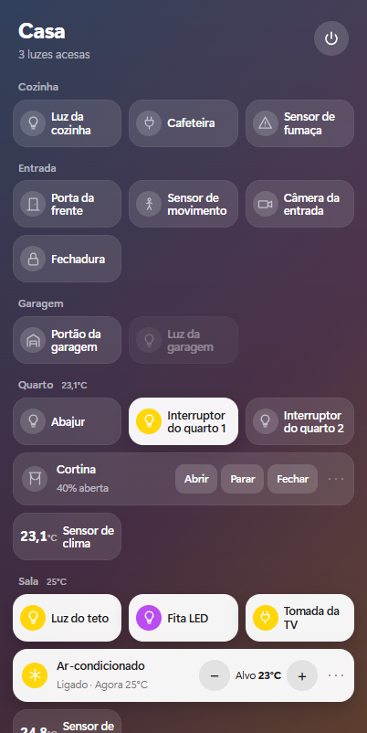

# Smart Home Widget

Painel para controlar uma casa com dispositivos **Tuya / Smart Life** direto do computador: um widget de bandeja para Windows, no estilo Central de Controle, e um dashboard web para abrir em qualquer aparelho da rede de casa.



## O que ele faz

- **Luzes**: cada tecla dos interruptores vira um botão, com o nome dado no app Smart Life. Um botão no topo apaga tudo.
- **Ar-condicionado** (via Smart IR): liga/desliga, temperatura, modo e ventilação.
- **TV** (via Smart IR): liga/desliga, volume e setas.
- **Apps da TV**: abre YouTube, Netflix e Prime Video direto pela rede Wi‑Fi, sem passar pelo infravermelho.
- **Google TV / Android TV**: controle remoto completo pela rede (setas, OK, Voltar, Início, volume, liga/desliga), sem Tuya nem infravermelho. A TV é encontrada sozinha na rede e pareada uma vez, com o código que ela mostra na tela.
- **Cômodos**: os dispositivos são agrupados pelos cômodos cadastrados no Smart Life.
- **Outros dispositivos Tuya** (lâmpadas com brilho e cor, tomadas, sensores, cortinas) aparecem automaticamente com controles genéricos.

## Como funciona

```text
Widget (Electron)  ─┐
                    ├─►  server.js  ─►  nuvem da Tuya  ─►  interruptores, Smart IR
Navegador na rede  ─┘        │
                             ├─►  TVs na rede local (DIAL)    ─►  YouTube, Netflix, Prime Video
                             └─►  Google TV (controle remoto) ─►  setas, OK, Voltar, Início, volume
```

- `server.js` é um servidor Node pequeno (a única dependência é `androidtv-remote`, para o controle de Google TV). Ele guarda as credenciais da Tuya, assina as chamadas e entrega a página. As chaves nunca chegam ao navegador.
- O widget é a mesma página em modo compacto (`/?widget`), dentro de uma janela Electron que fica na bandeja do Windows.
- Sem `config.json`, o servidor sobe em **modo demonstração**, com dispositivos simulados.

## Requisitos

- Windows 10/11 de 64 bits (para o widget) e [Node.js](https://nodejs.org) 18 ou mais recente.
- Dispositivos já cadastrados no app Smart Life ou Tuya Smart.
- Uma conta gratuita de desenvolvedor em [platform.tuya.com](https://platform.tuya.com).

## Configuração

### 1. Projeto na Tuya

1. Em [platform.tuya.com](https://platform.tuya.com): **Cloud → Development → Create Cloud Project**, tipo **Smart Home**, data center **Western America** (o que atende o Brasil).
2. Na aba **Service API**, autorize **IoT Core**, **Authorization Token Management** e **Smart Home Basic Service**.
3. Na aba **Devices → Link App Account**, escaneie o QR code com o app Smart Life (aba **Eu** → ícone de escanear).
4. Na aba **Overview**, copie o **Access ID** e o **Access Secret**.

### 2. Arquivo de configuração

Copie `config.example.json` para `config.json` e preencha:

```json
{
  "tuya": {
    "accessId": "SEU_ACCESS_ID",
    "accessSecret": "SEU_ACCESS_SECRET",
    "endpoint": "https://openapi.tuyaus.com"
  },
  "title": "Casa",
  "port": 5070,
  "rooms": {}
}
```

Campos opcionais:

| Campo | Para que serve |
|---|---|
| `title` | Nome que aparece no topo do painel. |
| `rooms` | Força o cômodo de um dispositivo, por nome ou ID: `{ "TV": "Quarto" }`. |
| `tvs` | Com mais de uma TV por infravermelho, diz de qual TV da rede são os atalhos de apps: `{ "nome na Tuya": "nome da TV na rede" }`. |
| `host` | Endereço em que o servidor escuta. O padrão `0.0.0.0` atende a rede local; use `127.0.0.1` para atender só o próprio computador. |

> O `config.json` fica fora do git de propósito. Quem tem essas chaves controla a casa.

### 3. Instalar e abrir

```bash
npm install
npm start        # abre o widget (e sobe o servidor junto)
```

Para usar só o dashboard no navegador, sem o widget: `npm run server` e abra `http://localhost:5070`.

## Usando o widget

- **Clique na casinha** ao lado do relógio do Windows, ou `Ctrl+Alt+H`, para abrir e fechar o painel.
- **Clique em uma luz** para acender ou apagar.
- **⋯** no Ar e na TV abre o controle completo. **Botão direito** em qualquer bloco abre os detalhes dele (brilho, cor, temporizador).
- **Botão direito na casinha**: fixar o painel na tela, iniciar com o Windows, abrir o dashboard completo ou sair.

O dashboard completo fica em `http://localhost:5070` e também responde a outros aparelhos no mesmo Wi‑Fi (o endereço aparece no terminal ao rodar `npm run server`).

## Gerar o app para outro computador

```bash
npm run dist
```

Cria a pasta `dist/Smart Home Widget-win32-x64` com o `Smart Home Widget.exe`, que roda sem instalar nada. Compacte a pasta, copie para o outro computador e extraia em um local fixo. O `config.json` vai junto, então trate o pacote com o mesmo cuidado que as chaves.

## Arquivos

| Arquivo | Papel |
|---|---|
| `server.js` | Servidor: ponte com a Tuya, apps da TV pela rede, modo demonstração |
| `main.js` | Widget de bandeja (Electron) |
| `index.html`, `app.js`, `style.css` | Dashboard e painel compacto do widget |
| `config.example.json` | Modelo do arquivo de configuração |

## Segurança

O servidor não tem login. As barreiras que existem:

- só responde a conexões vindas do próprio computador ou de endereços de rede local;
- recusa pedidos cujo cabeçalho `Host` não seja `localhost` ou um IP local, o que barra ataques de DNS rebinding;
- só aceita comandos em JSON e vindos da própria página, o que impede um site aberto no navegador de acionar a casa.

Mesmo assim, qualquer pessoa conectada ao seu Wi‑Fi consegue abrir o dashboard e controlar os dispositivos. Não exponha a porta à internet, e use `"host": "127.0.0.1"` se não precisar do acesso por outros aparelhos.

O `npm audit` aponta vulnerabilidades conhecidas em dependências do `androidtv-remote` (`node-forge` e `protobufjs`), sem correção disponível na versão atual da biblioteca. Elas só entram em jogo na conversa com a Google TV dentro da rede local.

## Limites conhecidos

- **Sem login.** Veja a seção Segurança.
- **Testado em poucos aparelhos**: interruptores de parede Tuya, um Smart IR com ar-condicionado e TV, uma TV AOC (apps via DIAL) e uma Google TV TCL. Os demais tipos de dispositivo usam controles genéricos e só foram exercitados no modo demonstração.
- **Depende da nuvem da Tuya.** Sem internet, luzes e ar não respondem. O plano gratuito da Tuya tem período de teste que precisa ser renovado no site.
- **Ar e TV por infravermelho não informam estado real.** O painel mostra o último comando enviado; o controle físico não é detectado.
- **OK, Voltar e Início da TV por infravermelho** exigem autorizar o serviço **IR Control Hub Open Service** no projeto da Tuya. Sem ele, esses botões não aparecem. Esse caminho foi escrito a partir da documentação e ainda não foi testado com o serviço ativo.
- **Apps da TV** só funcionam com a TV ligada e no mesmo Wi‑Fi do computador, e só para os apps que a TV oferece por esse caminho.
- **Sem medição de energia**, a não ser que o dispositivo tenha medidor próprio.

## Licença

[MIT](LICENSE)
